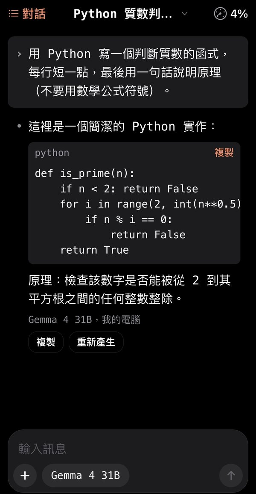
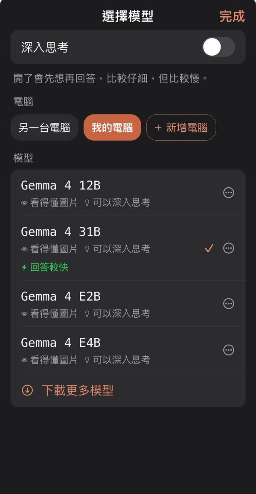
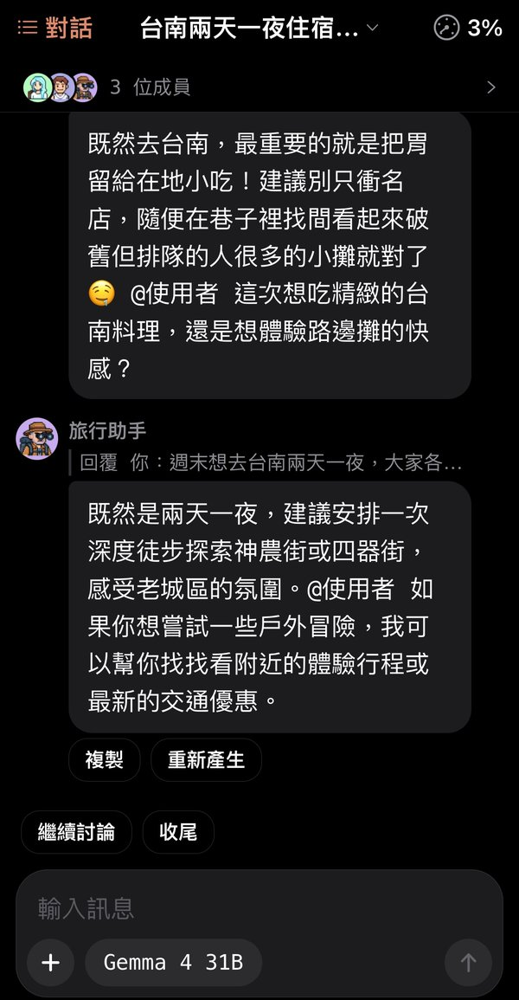

# Local AI (local-chat)

**English** | [繁體中文](README.zh-TW.md)

[](https://github.com/yu-ken0207/local-chat/actions/workflows/test.yml) [](LICENSE)

An iPhone app for chatting with the AI models on your own computer (Ollama or LM Studio). No cloud, no account, no subscription: chats stay on your phone and only go to your own computer.

<p>
  
  
  
</p>

## Why

- **Private**: chats are stored on the phone and sent only to a computer you connected. Pairing tokens live in the iOS Keychain, not in the database or backups.
- **One computer for the whole family**: run [Local AI Helper](https://github.com/yu-ken0207/local-ai-helper) on the computer with the GPU, and every phone pairs by scanning a QR code.
- **Works away from home**: on the same Wi-Fi, or with Tailscale on both the phone and the computer.
- **No manual needed**: the first screen says "Connect your computer". When something goes wrong, the app finds the cause (phone not on Wi-Fi, not on the same network, helper not running, computer asleep or behind a firewall, Tailscale off) and tells you what to do.

## Features

- Streaming answers with Markdown, copyable code, and math shown as readable symbols
- Photos from the camera or several from the library, for models that understand images
- Thinking switch for reasoning models
- Multi-agent discussions: several agents talk in one chat (free-for-all, moderator, round-robin, or only when @mentioned), with 788 built-in roles, pixel-art avatars, votes, conclusion cards, and notes for each agent
- Phone actions: the AI can look at your calendar, add events, and set reminders. You confirm on a card first, and you can undo.
- Context gauge in the top-right corner. At 80%, the app quietly condenses earlier messages into a summary instead of asking you to start a new chat.
- Download models from the phone, with suggestions based on the computer's memory and GPU. With the helper, downloads run on the computer and keep going after you close the app.
- Preload and unload models; regenerate (old answers are kept), edit and resend, undo deletes, and Recently Deleted for 30 days
- Backup and restore; Traditional Chinese and English interface (follows the system or set in the app)

## Quick start

The app is not on the App Store. It runs in [Expo Go](https://apps.apple.com/app/expo-go/id982107779).

You need:

- Expo Go on your iPhone
- A computer with Node.js (LTS) to start the app
- A computer running Ollama or LM Studio (can be the same one)

```bash
git clone https://github.com/yu-ken0207/local-chat.git
cd local-chat
npm install
npx expo start
```

1. Scan the QR code in the terminal with the iPhone camera. The app opens in Expo Go (the phone and the computer must be on the same Wi-Fi).
2. On the computer that runs the AI, start [Local AI Helper](https://github.com/yu-ken0207/local-ai-helper). In the app, tap **Connect your computer** and scan the QR code on the helper's page. You can also connect to Ollama directly without the helper; the app shows setup steps for macOS, Windows, and Linux.

## Development

```bash
npm test            # unit and component tests
npm run typecheck   # type check
npm run test:live   # tests against a real server (set LIVE_HOSTS etc., see test/live/ollama.live.test.ts)
npx expo start      # dev server; open in Expo Go
```

- GitHub Actions runs the type check and all tests on every push to main and every pull request.
- Add packages with `npx expo install <package>` so versions match Expo SDK 58.
- Only native modules built into Expo Go are used; nothing that needs a development build.
- Interface text is written as `t('Traditional Chinese source')`, and the English is in `src/i18n/en.ts`. `test/i18n.test.ts` checks that no Chinese text is left unwrapped and that every key has an English translation with matching parameters.

```
App.tsx            entry point
src/lib/           pure logic (Ollama connection, stream parsing, LAN scan, formatting…), all unit tested
src/store/         on-device database (chats, messages, photos, computers, settings)
src/components/    screens and components
test/              tests; test/live/ runs against real servers and is not part of npm test
```

The development log and design documents are in Chinese: see the [Chinese README](README.zh-TW.md) and `docs/`.

## License

Code is licensed under [Apache-2.0](LICENSE). The agent roles in the catalog come from lobehub/lobe-chat-agents and msitarzewski/agency-agents (both MIT); see [THIRD_PARTY_NOTICES.md](THIRD_PARTY_NOTICES.md).
