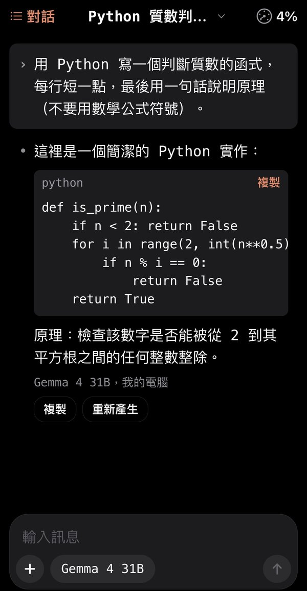
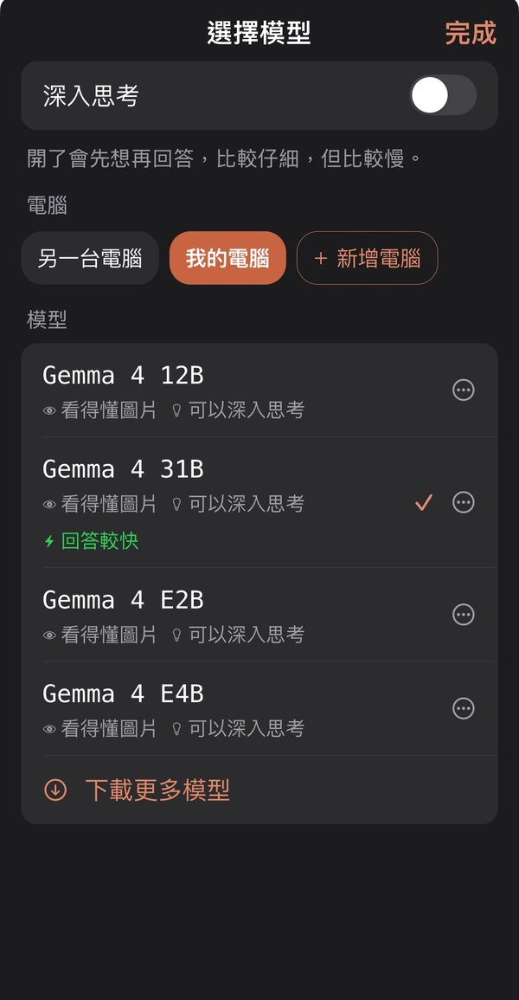
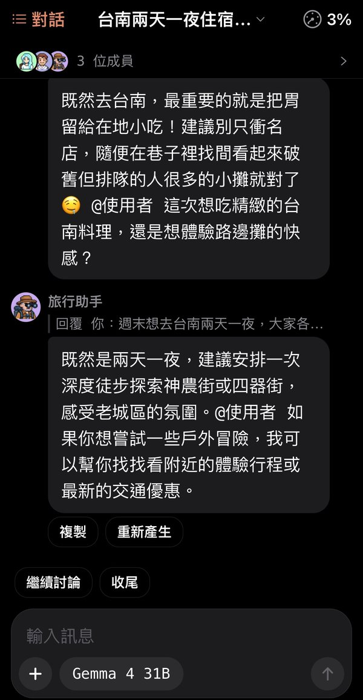

# local-chat（Local AI）

[English](README.md) | **繁體中文**

[](https://github.com/yu-ken0207/local-chat/actions/workflows/test.yml) [](LICENSE)

連自己地端 Ollama 主機的 iPhone 聊天 App，App 名稱「Local AI」（Expo / React Native，用 Expo Go 執行）。以聊天為主，模型看得懂圖時也能傳照片。

<p>
  
  
  
</p>

## 快速開始

需要：iPhone 上的 [Expo Go](https://apps.apple.com/app/expo-go/id982107779)、一台裝了 Node.js（LTS 版）的電腦，以及一台跑著 Ollama 或 LM Studio 的電腦（可以是同一台）。

```bash
git clone https://github.com/yu-ken0207/local-chat.git
cd local-chat
npm install
npx expo start
```

1. 用 iPhone 的相機掃終端機上的 QR code，會用 Expo Go 打開 App（手機和電腦要在同一個 Wi-Fi）。
2. 在跑 AI 的電腦上開 [Local AI 小幫手](https://github.com/yu-ken0207/local-ai-helper)，App 裡按「連接你的電腦」，掃小幫手管理頁上的 QR code。不裝小幫手也可以直接連 Ollama，App 裡有各系統的設定步驟。

## 功能

設計原則：第一次打開、不看說明也能上手（不做教學頁，讓介面本身夠直覺）。

- **跟電腦配對**：電腦裝 Local AI 小幫手（另一個專案 [local-ai-helper](https://github.com/yu-ken0207/local-ai-helper)），手機掃電腦畫面上的 QR code 就配對（也可以自動尋找後輸入 6 位數配對碼）；權杖放 iOS 鑰匙圈、不進資料庫與備份；小幫手換位址也認得；電腦上移除這支手機時會提示重新配對。不用小幫手也能直接連 Ollama（進階）
- **第一次打開就能用**：空白畫面直接給「連接你的電腦」；自動尋找同一個 Wi-Fi 的 Ollama，也能手動輸入位址；連上就自動選好模型
- **連不上時告訴你怎麼辦**：Mac／Windows／Linux 的設定步驟與可複製的指令，錯誤下方有「重試」「連線說明」「詳細資訊」；連得到電腦但上面沒有開著的 AI 引擎時，說要到小幫手按「安裝 Ollama」或「打開 Ollama」。連不到時先找原因再說：手機沒連 Wi-Fi、和電腦不在同一個網路、電腦開著但小幫手沒開（馬上被拒絕）、電腦沒回應（睡著、關機、防火牆）、Tailscale 沒開；小幫手換了位址會自己找到並改好、再問一次。送出時同時確認連不連得到（只問小幫手的 hello，不經過 AI 引擎），連不到幾秒內就說，不用等到聊天逾時
- **等第一個字時說明在等什麼**：模型還沒載入時顯示「正在載入模型」並說明第一次要等 30 秒到 1 分鐘；已載入但很久才回時說電腦在讀前面的對話；超過 90 秒說可能記憶體不夠
- **對話清單是左邊的側邊欄**：手指往右滑打開（畫面跟著手指走，輕撥也行）、往左滑或點旁邊關上；搜尋、長按或 ⋯ 改名／刪除，設定固定在最下面
- **聊天**：回答逐字出現、Markdown 排版、程式碼可複製、照片（拍照、相簿多張）；點標題可以改名或刪除這段對話；開新對話在對話清單最上面（右上角放用量，盡量留在同一段聊）
- **快滿了自動整理**：一般聊天回答完用到八成，就在背景把前面的對話整理成前情摘要（不跳提示、不叫人開新對話）；之後送給 AI 的是「摘要＋最近大約三成的原文」，手機上的訊息都還在；對話裡有一條「前面的內容已整理成摘要」，點了看摘要；用量面板也能按「現在整理」。編輯、刪掉已經整理過的訊息時摘要作廢，下次再整理。多 AI 討論有自己的前情摘要。真模型實測（`test/live/compact*.live.test.ts`，Gemma 4 31B、32K）：12 個關鍵事實整理後都還記得；跟 Codex 的做法比（同一段對話各考 3 次），我們 41/45、Codex 36/45（英文摘要把飯店名稱翻回中文時翻錯）、Codex 原版 39/45 但送出的多一倍、整段原文 45/45
- **輸入框**：一整塊圓角框，字在上面，下面一排是「＋」（附照片）、模型那顆、送出；模型那顆跟思考合成一顆（開著時寫「思考」或程度），點了打開選模型，深入思考的開關在面板最上面
- **用量**：右上角是小儀表加百分比（指針照實際的百分比轉，快滿變橘、滿了變紅），是這段 AI 記住的內容用了多少，回答時一路跟著變（先估，答完換成模型回報的實際值）；點了打開用量面板：上半圓儀表、各部分約多少（對話內容、系統說明、工具說明、角色與筆記、前情摘要、照片）、這台電腦載入的模型（顯示卡記憶體、最多記住多少、多久後卸載）、今天與這 7 天的累計（依模型、背景工作佔多少）。紀錄只有數字、留 90 天，模型閒置卸載後照樣用上次的上限
- **從手機下載模型**：選模型面板的「下載更多模型」（電腦還沒有模型時直接是「選一個模型下載」）；依電腦配備（小幫手回報的記憶體與顯示卡）推薦一個、每個標出跑不跑得動；透過小幫手時在電腦上下載，手機關掉也會繼續，回來接著顯示進度；下載好這段對話還沒選模型就直接用它；也能用名稱下載其他模型。推薦清單在 `src/lib/catalog.ts`
- **模型可以預先載入／卸載**：選模型清單的 ⋯，載入時那一列顯示進度；引擎做不到（OpenAI 格式伺服器）就不出現這個選項；模型來自好幾個引擎時標出是哪個（例如 LM Studio）
- **看得懂**：模型名稱白話（Gemma 4 · 12B）、按鈕都有文字、進階資訊（速度、原始名稱、資料庫位置）收在「詳細資訊」與設定的「進階」
- **不怕按錯**：刪除直接做、可以「復原」；寫到一半按取消會先問；花時間的動作（連線、載入模型）有進度；刪掉的對話在「最近刪除」保留 30 天；重新產生保留舊回答（‹ 1/2 ›）；編輯重送可以復原
- **每個人自訂**：語言跟著系統、也能在 App 裡改（繁中／English，AI 也用這個語言回答）；備份與還原
- 對話只存在手機（SQLite），只會送到使用者自己的電腦

## 開發

程式碼主檔在開發機（這個 repo），執行與測試在另一台 Windows 電腦（跑 Expo 開發伺服器），改完同步過去。

```bash
npm test            # 單元測試＋元件測試
npm run typecheck   # 型別檢查
npm run test:live   # 打真主機（要設 LIVE_HOSTS 等環境變數，見 test/live/ollama.live.test.ts）
npx expo start      # 開發伺服器，iPhone 用 Expo Go 打開
```

- 每次 push 到 main 或開 PR，GitHub Actions 會跑型別檢查和全部測試（`.github/workflows/test.yml`）。
- 新增套件一律用 `npx expo install <套件>`（會挑跟 Expo SDK 58 相容的版本）。
- 只用 Expo Go 內建的原生模組；需要開發版（development build）的套件先不加。
- 介面照 apple-design，外觀參考 Codex 終端介面（等寬字、› 是使用者、• 是 AI）。

## 結構

```
App.tsx            進入點
src/lib/           純邏輯（Ollama 連線、串流解析、掃描區網、格式化…），都有單元測試
src/store/         手機資料庫（對話、訊息、照片、主機、設定；templates 表是舊版留下的，只為了舊備份能還原）
src/components/    畫面元件
test/              測試；test/live/ 是打真主機的測試，不在 npm test 裡跑
```

## 進度

| 階段 | 內容 | 狀態 |
|---|---|---|
| 0–6 | 骨架、連線層、資料庫、聊天畫面、對話管理、訊息操作與範本、回歸 | 完成 |
| B | 第一次打開就能用：連接電腦、連線說明、自動選模型、白話錯誤與重試 | 完成 |
| C | 看得懂：白話模型名稱、按鈕加文字、左滑刪除、進階資訊收起來 | 完成 |
| D | 不怕按錯：復原、最近刪除 30 天、回答版本 | 完成 |
| E | 設定頁、備份與還原、中英雙語（跟著系統或自訂） | 完成 |
| F | 對話清單改成側邊欄（右滑打開）、App 名稱 Local AI、各頁互動細節 | 完成 |
| G | 功能精簡：拿掉 9 項少用的功能，再拿掉範本與自訂指示 | 完成 |
| H | 跟 Local AI 小幫手配對（掃 QR code、配對碼、權杖、換位址） | 完成 |
| I | 從手機下載模型（依配備推薦）、依引擎隱藏做不到的功能 | 完成 |
| J | 連不到時說出原因（含自動找回換了位址的電腦）、第一次載入模型的等待說明 | 完成 |
| K | 手機上動手做事（加行程、設提醒，先確認、能復原），設計見 [docs/設計_手機上動手做事.md](docs/設計_手機上動手做事.md) | 第一版完成（2026-10-29）：K1 小幫手轉送工具、K2 做事框架（做事循環、確認卡、動作紀錄與復原）、K3 行事曆與提醒事項（看行事曆、加行程、加提醒，沒權限給「打開設定」，設定頁「AI 可以做的事」與「做過的事」）、K4 反問選擇題與清單卡（一次好幾件，可以取消勾選、修改其中一件）、K5 題庫評測（`eval/tools/`：提示詞加日期對照表後 31b 100%、12b 88%、qwen3:4b 88%、e4b／e2b 68%）、K6 iPhone 實測 10 項全過（測試主機的 31B，找到的 4 個問題已修，見設計文件第 14 節）。2026-10-30 第二輪：「修改」改用時間選擇器、沒按卡片直接打字寫「跳過」，iPhone 實測 13 項全過（再修 3 個） |
| L | 多 AI 討論（一段對話裡好幾個 Agent 自己搶話討論、圖鑑 788 個、像素頭像、投票與結論卡、每個 Agent 的筆記），設計見 [docs/設計_多AI討論.md](docs/設計_多AI討論.md) | 第一版完成（2026-10-30）：M1 資料層與圖鑑、M2 設定的 Agent 頁、M3 討論引擎（自由搶話／主持人／輪流／只回 @、插話、暫停、AI 自己加入、前情摘要）、M4 聊天氣泡與成員面板、M5 收尾投票結論卡與筆記、M6 討論串多人、M7a 頭像生產線與換頭像、M7b 788 張像素頭像（C 細緻陰影風，共 1.3 MB）、M8a 真模型實測（測試主機，31B、12B）。還沒做：iPhone 驗收 |
| M | 用量（右上角小儀表、用量面板、每次叫模型的紀錄）、快滿了自動整理成前情摘要、輸入框改版（模型與思考合成一顆） | 完成（2026-10-31），iPhone 看過右上角、用量面板、新輸入框 |

功能精簡（10/28）的細節：拿掉朗讀、AI 回答語言、自動取標題開關（固定開）、剪貼簿照片、匯出 Markdown、電腦改名與在線狀態；之後再拿掉範本功能與每段對話的自訂指示（舊資料裡的自訂指示不再送出）

審查清單（UI/UX 與鍵盤、資安、多 AI 討論）與手機驗收清單是內部文件，不放在 repo 裡（2026-10-31 整理公開前移出）。

手機驗收：2026-10-29 透過開發機上的小幫手（iPhone 用 4G＋Tailscale）實機測過：配對、聊天與第一次載入、從手機下載、預先載入／卸載（含 LM Studio、看圖）、連不到的說明（小幫手沒開、手機 Tailscale 沒開）、側邊欄與對話管理、訊息操作與照片、設定／語言／備份還原。還沒在 iPhone 上測：同一個 Wi-Fi 直接連（自動尋找、手動輸入位址、電腦換位址自動改好、不在同一個網路）、直接連 Ollama（沒有小幫手）。
測試中修掉：配對成功後畫面卡住（兩層畫面同時關）、一定會思考的模型（qwen3:4b）思考混在回答裡、用名稱下載打錯沒馬上說、透過 Tailscale 時把「小幫手沒開」說成 Tailscale 的問題。

## 翻譯

畫面文字一律寫成 `t('繁體中文原文')`，英文在 `src/i18n/en.ts`（key 是中文原文）。`test/i18n.test.ts` 會檢查：程式裡沒有漏包的中文、每個 key 都有英文且參數一致。給 AI 的指示（回答語言、取標題）不跟著畫面翻譯，標 `i18n-ignore`。

## 授權（License）

程式碼採 [Apache-2.0](LICENSE)。圖鑑的 Agent 角色內容來自 lobehub/lobe-chat-agents 與 msitarzewski/agency-agents（都是 MIT 授權），授權全文見 [THIRD_PARTY_NOTICES.md](THIRD_PARTY_NOTICES.md)。
